  

  
  
  
  
  
  
  

---

# 🚀 Awesome Full Lifecycle API Management

> 🌟 **A carefully curated index of enterprise SaaS platforms, ultra-fast open-source API gateways, developer portals, contract-testing tools, and API governance frameworks.**

**Full Lifecycle API Management** encompasses every phase of the API journey:
1. 📐 **Plan & Design** — OpenAPI / AsyncAPI modeling, schema validation, linting, and mocking.
2. 🛡️ **Secure & Enforce** — Authentication (OAuth2, OIDC, mTLS), rate limiting, DDoS mitigation, and policy enforcement.
3. ⚡ **Runtime Traffic Management** — Reverse proxying, routing, protocol mediation (REST, GraphQL, gRPC, WebSocket), and service meshing.
4. 🌐 **Publish & Onboard** — Self-service developer portals, interactive documentation, API catalogs, and SDK generation.
5. 📊 **Observe & Monetize** — Metrics collection, distributed tracing, alerting, usage metering, and billing.

---

## 📑 Table of Contents

- [🌐 Sector Overview & Market Dynamics](#-sector-overview--market-dynamics)
- [☁️ SaaS & Hosted Platforms](#️-saas--hosted-platforms)
- [💻 Open-Source GitHub Projects](#-open-source-github-projects)
- [🛠️ Architectural Recipes for Custom Stacks](#️-architectural-recipes-for-custom-stacks)
- [📈 Star History](#-star-history)
- [💖 Support & Community](#-support--community)
- [🤝 How to Contribute](#-how-to-contribute)
- [⚖️ Disclaimer](#️-disclaimer)

---

## 🌐 Sector Overview & Market Dynamics

The global **Full Lifecycle API Management market** was valued at approximately **$5.1 Billion in 2023** and is projected to surpass **$18.2 Billion to $23.0 Billion by 2030**, expanding at a Compound Annual Growth Rate (CAGR) of **25.5% – 28.1%**.

### 📊 Market Concentration & Fragmentation:
* **Moderate Concentration at the Enterprise Core**: The market is moderately concentrated at the top tier among major cloud hyperscalers (**Microsoft Azure, AWS, Google Cloud Apigee**) and legacy enterprise integration platforms (**Salesforce MuleSoft, IBM API Connect**), which dominate Global 2000 digital transformation engagements.
* **High Fragmentation Across Developer-First & Open-Core Layers**: The broader sector is **not a winner-take-all market**. Growing adoption of microservices, multi-cloud architectures, edge computing, and AI-driven API consumption has fueled strong market fragmentation. Modern open-core innovators (**Kong, Apache APISIX, Tyk, Gravitee.io, Postman, Hoppscotch**) capture significant developer-led traction due to their self-hosted privacy, ultra-low latency runtimes, and GitOps-friendly workflows.

---

## ☁️ SaaS & Hosted Platforms

A comparison of leading hosted API management solutions. The table is ordered by **Company Size (Market Capitalization or Valuation)** in descending order.

| 🏢 Platform / Vendor | 📈 Company Size (Valuation / Revenue) | 💳 Starting Price | 🎁 Free Tier Limits & Free Trial | 🌟 Key Capabilities & Architecture |
| :--- | :--- | :--- | :--- | :--- |
| **[Azure API Management](https://azure.microsoft.com/en-us/products/api-management/)** | **~$3.1 Trillion** Market Cap (~$245B Ann. Rev.) | **$0.00 base** + $3.50 / 1M calls (Consumption) or **$48.04/month** (Developer Tier) | **Free Forever**: 1,000,000 calls/month included on the Serverless Consumption tier | Hybrid and multi-cloud API management with self-hosted gateways, Azure Active Directory / Entra ID integration, policy engines, and developer portals. |
| **[Google Cloud Apigee](https://cloud.google.com/apigee)** | **~$2.1 Trillion** Market Cap (~$307B Ann. Rev.) | **~$365/month** base environment + **$20 / 1M calls** (Pay-as-you-go) | **60-Day Free Trial**: Sandbox evaluation environment with full proxy capabilities (plus $300 GCP credits for 90 days) | Enterprise-grade API management platform featuring hybrid runtime options, advanced AI-powered security, analytics, and developer portal monetization. |
| **[AWS API Gateway](https://aws.amazon.com/api-gateway/)** | **~$1.9 Trillion** Market Cap (~$575B Total / ~$105B AWS Rev.) | **$1.00 / 1M calls** (HTTP APIs) or **$3.50 / 1M calls** (REST APIs) | **12-Month Free Tier**: 1,000,000 REST/HTTP calls/month + 1,000,000 WebSocket messages/month | Fully managed serverless API gateway with AWS Lambda native integration, Cognito/IAM auth, canary deployments, and AWS WAF firewall integration. |
| **[Salesforce MuleSoft Anypoint Platform](https://www.mulesoft.com/platform/anypoint-platform)** | **~$280 Billion** Market Cap (~$35B Ann. Rev.) | **~$2,000/month** (Integration Starter, billed annually) | **30-Day Free Trial**: Complete platform evaluation with Anypoint Studio, Design Center, and Exchange | Unified API management and iPaaS integration suite. Features API Designer, Anypoint Exchange asset catalog, policy enforcement, and Anypoint Monitoring. |
| **[IBM API Connect](https://www.ibm.com/products/api-connect)** | **~$210 Billion** Market Cap (~$62B Ann. Rev.) | **~$83/month** (Standard SaaS tier on AWS/IBM Cloud) | **30-Day Free Trial**: 1 service instance with up to 100,000 API calls included at no charge | Comprehensive enterprise suite for API creation, management, security, and socialization across hybrid multi-cloud environments. |
| **[Postman](https://www.postman.com/)** | **~$5.6 Billion** Valuation (~$100M+ ARR) | **$9/user/month** (Solo, billed annually) or **$19/user/month** (Team) | **Free Forever**: 1 user with unlimited collection runs, unlimited mock servers, and 50 AI credits/month | Industry-standard API collaborative workspace supporting API design, automated test suites, mock servers, documentation, and monitors. |
| **[Kong Konnect](https://konghq.com/products/kong-konnect)** | **~$2.0 Billion** Valuation (~$100M+ ARR) | **~$25/month** base (Konnect Plus serverless control plane) + usage charges | **30-Day Free Trial**: Full access to Konnect Plus enterprise features, hybrid control plane, and 30-day analytics retention | Cloud-hosted control plane for Kong Gateway runtimes across multi-cloud and Kubernetes, featuring service catalog, developer portal, and mesh management. |
| **[WSO2 API Platform / Choreo](https://wso2.com/api-manager/)** | **~$650 Million** Valuation (Acquired by EQT, ~$125M ARR) | **$150/component/month** (Choreo Team tier) | **Free Forever**: Up to 5 APIs, 10 Developer Portal apps, and 1,000,000 requests/month | Cloud-native API management and internal developer platform. Provides API publisher, marketplace portal, and automated Kubernetes deployments. |
| **[Gravitee Cloud](https://www.gravitee.io/)** | **~$350 Million** Valuation ($110M+ Raised, ~$30M ARR) | **~$2,500/month** (Managed Enterprise Cloud tier) | **14-Day Free Trial**: Full access to Gravitee Enterprise Edition APIM and event broker integrations (no credit card required) | Event-native API management platform connecting synchronous REST/GraphQL with asynchronous protocols like Kafka, MQTT, and WebSockets. |
| **[Tyk Cloud](https://tyk.io/)** | **~$120 Million** Valuation ($43M Raised, ~$25M ARR) | **~$450/month** (Tyk Cloud Starter tier) | **48-Hour Free Trial**: Full access to managed Tyk Cloud control plane, developer portal, and analytics (no credit card required) | Cloud-managed control plane for the high-performance Go-based Tyk Gateway with native GraphQL engine, multi-data center clustering, and developer portal. |

---

## 💻 Open-Source GitHub Projects

Explore the most popular open-source API gateways, developer portals, specifications, and contract testing tools. The list is sorted by **GitHub_Stars** in descending order.

1. **[Hoppscotch](https://github.com/hoppscotch/hoppscotch)**   
   *License: MIT* | ⭐ **80,000+ Stars**  
   Open-source, web-first API development ecosystem and testing suite. Fast, lightweight alternative to Postman supporting REST, GraphQL, and WebSocket protocols with team workspaces.

2. **[Caddy](https://github.com/caddyserver/caddy)**   
   *License: Apache-2.0* | ⭐ **77,000+ Stars**  
   Fast, extensible multi-platform HTTP/2 and HTTP/3 reverse proxy and API gateway with automated TLS/HTTPS certificate provisioning via Let's Encrypt and modular Go architecture.

3. **[Traefik](https://github.com/traefik/traefik)**   
   *License: MIT* | ⭐ **65,000+ Stars**  
   Cloud-native HTTP reverse proxy and load balancer. Integrates seamlessly with Kubernetes Ingress, Docker, and Consul, featuring real-time automated service discovery, canary routing, and Let's Encrypt SSL.

4. **[Bruno](https://github.com/usebruno/bruno)**   
   *License: MIT* | ⭐ **47,000+ Stars**  
   Fast, Git-friendly, offline-first open-source API client that stores collections directly as plain-text files in your local folders, eliminating vendor cloud locks and syncing easily with Git.

5. **[Kong Gateway](https://github.com/Kong/kong)**   
   *License: Apache-2.0* | ⭐ **44,000+ Stars**  
   The world's most adopted open-source microservice API gateway. Built on OpenResty/Nginx with a pluggable architecture for authentication (OAuth2, JWT, Key), rate limiting, traffic splitting, and observability.

6. **[Kong Insomnia](https://github.com/Kong/insomnia)**   
   *License: Apache-2.0* | ⭐ **40,000+ Stars**  
   Open-source desktop API client and design tooling platform for GraphQL, REST, WebSockets, and gRPC. Features native Git sync and OpenAPI design editing.

7. **[Backstage](https://github.com/backstage/backstage)**   
   *License: Apache-2.0* | ⭐ **34,000+ Stars**  
   Open platform for building developer portals created by Spotify. Centralizes service discovery, API documentation catalogs (OpenAPI, AsyncAPI, gRPC), software templates, and technical governance.

8. **[Envoy Proxy](https://github.com/envoyproxy/envoy)**   
   *License: Apache-2.0* | ⭐ **29,000+ Stars**  
   Cloud-native high-performance edge and service proxy designed for modern cloud architectures. Powers service meshes (Istio) and serves as the data-plane engine for top enterprise API gateways.

9. **[Swagger UI](https://github.com/swagger-api/swagger-ui)**   
   *License: Apache-2.0* | ⭐ **29,000+ Stars**  
   Standard visual rendering tool for generating interactive, browser-based API documentation directly from OpenAPI (Swagger) specifications with built-in "Try it out" execution.

10. **[OpenAPI Generator](https://github.com/OpenAPITools/openapi-generator)**   
    *License: Apache-2.0* | ⭐ **26,000+ Stars**  
    Universal code generator supporting 50+ client SDKs, server stubs, and documentation generators directly from OpenAPI (v2.0, v3.0, v3.1) definitions.

11. **[Redoc](https://github.com/Redocly/redoc)**   
    *License: MIT* | ⭐ **25,000+ Stars**  
    Clean, responsive three-panel documentation generator for OpenAPI definitions with support for Markdown descriptions, schema drill-down, and code sample tabs.

12. **[Apache APISIX](https://github.com/apache/apisix)**   
    *License: Apache-2.0* | ⭐ **17,000+ Stars**  
    Ultra-high-performance dynamic API gateway built on Nginx and etcd. Provides hot-reloaded configuration, multi-protocol translation (HTTP, gRPC, MQTT), and native Kubernetes Ingress integration.

13. **[Scalar](https://github.com/scalar/scalar)**   
    *License: MIT* | ⭐ **16,000+ Stars**  
    Modern, interactive open-source API reference documentation tool and API client designed for OpenAPI and Swagger specifications with themeable UI and high accessibility.

14. **[Netflix Zuul](https://github.com/Netflix/zuul)**   
    *License: Apache-2.0* | ⭐ **14,000+ Stars**  
    Java-based edge service gateway engineered by Netflix to deliver dynamic routing, monitoring, resilient load shedding, and security across massive microservice clusters.

15. **[Tyk Gateway](https://github.com/TykTechnologies/tyk)**   
    *License: MPL-2.0* | ⭐ **10,000+ Stars**  
    Lightweight, fast, open-source API gateway written in Go. Features native GraphQL orchestration, token rate limiting, and polyglot plugin support (Go, Python, JS, gRPC).

16. **[Apache ShenYu](https://github.com/apache/shenyu)**   
    *License: Apache-2.0* | ⭐ **8,800+ Stars**  
    High-performance asynchronous Java API gateway. Delivers dynamic routing, rate limiting, and observability for HTTP, Apache Dubbo, Spring Cloud, gRPC, and SOFA protocols.

17. **[Ocelot](https://github.com/ThreeMammals/Ocelot)**   
    *License: MIT* | ⭐ **8,700+ Stars**  
    Open-source API gateway built specifically for .NET and ASP.NET Core microservice architectures, featuring routing, request aggregation, authentication, and Consul service discovery.

18. **[Mockoon](https://github.com/mockoon/mockoon)**   
    *License: MIT* | ⭐ **8,400+ Stars**  
    Fastest way to design, configure, and run mock APIs locally. Supports proxy mode, regex routing, automated latency injection, and CLI dockerization for CI pipelines.

19. **[WireMock](https://github.com/wiremock/wiremock)**   
    *License: Apache-2.0* | ⭐ **7,300+ Stars**  
    Flexible HTTP-based API simulation tool. Enables verification of edge failures, stateful scenarios, response templating, and record-and-playback mocking for automated testing.

20. **[Stoplight Prism](https://github.com/stoplightio/prism)**   
    *License: Apache-2.0* | ⭐ **5,000+ Stars**  
    Open-source HTTP mock and proxy server that parses OpenAPI v2/v3 documents to generate contract-compliant mock APIs with automatic request and response validation.

21. **[Spring Cloud Gateway](https://github.com/spring-cloud/spring-cloud-gateway)**   
    *License: Apache-2.0* | ⭐ **4,900+ Stars**  
    Reactive API gateway built on Spring Framework and Project Reactor. Designed for Java ecosystems seeking non-blocking routing, security filters, and circuit breaking.

22. **[Emissary-Ingress](https://github.com/emissary-ingress/emissary)**   
    *License: Apache-2.0* | ⭐ **4,500+ Stars**  
    Kubernetes-native API gateway and ingress controller built on Envoy Proxy (formerly known as Ambassador). Handles ingress routing, TLS termination, and OAuth integration via CRDs.

23. **[Stoplight Spectral](https://github.com/stoplightio/spectral)**   
    *License: Apache-2.0* | ⭐ **3,200+ Stars**  
    Flexible JSON/YAML and OpenAPI linter for automating API style guides, structural checks, and contract validation within continuous integration pipelines.

24. **[KrakenD](https://github.com/krakend/krakend-ce)**   
    *License: Apache-2.0* | ⭐ **2,600+ Stars**  
    Ultra-performant, stateless API gateway written in Go. Capable of handling tens of thousands of requests per second with negligible memory footprints and zero external database dependencies.

25. **[Apache APISIX Dashboard](https://github.com/apache/apisix-dashboard)**   
    *License: Apache-2.0* | ⭐ **1,200+ Stars**  
    Visual control plane for Apache APISIX. Allows administrators to visually configure routes, upstreams, SSL certificates, consumer rate limits, and custom plugins.

26. **[WSO2 API Manager](https://github.com/wso2/product-apim)**   
    *License: Apache-2.0* | ⭐ **1,000+ Stars**  
    Comprehensive enterprise open-source API management suite. Features API Publisher, Developer Portal, API Gateway runtime, Key Manager, and streaming API analytics.

27. **[Gravitee.io API Management](https://github.com/gravitee-io/gravitee-api-management)**   
    *License: Apache-2.0* | ⭐ **450+ Stars**  
    Open-core, event-native API management solution. Features drag-and-drop policy designer, developer portal, real-time alert engine, and protocol mediation for REST, GraphQL, and Kafka.

28. **[Solo.io Gloo Edge](https://github.com/solo-io/gloo)**   
    *License: Apache-2.0* | ⭐ **170+ Stars**  
    Feature-rich Kubernetes-native ingress controller and API gateway built on Envoy Proxy. Supports legacy microservices, gRPC, GraphQL, and serverless functions with zero configuration drift.

---

## 🛠️ Architectural Recipes for Custom Stacks

Building a fully independent, enterprise-grade, self-hosted API management platform is achievable by composing specialized open-source tools:

* **Runtime Data Plane**: Deploy **[Kong Gateway](https://github.com/Kong/kong)** or **[Apache APISIX](https://github.com/apache/apisix)** for microsecond traffic routing, rate limiting, and JWT enforcement.
* **API Developer Portal & Discovery**: Use **[Backstage](https://github.com/backstage/backstage)** with the API Docs plugin for a centralized internal developer catalog.
* **Specification & Governance**: Enforce design-first workflows using **[Stoplight Spectral](https://github.com/stoplightio/spectral)** in GitHub Actions alongside **[OpenAPI Generator](https://github.com/OpenAPITools/openapi-generator)** for automated SDK publishing.
* **Interactive Documentation**: Embed **[Scalar](https://github.com/scalar/scalar)** or **[Redoc](https://github.com/Redocly/redoc)** directly within portals for modern interactive API references.
* **API Testing & Mocking**: Pair **[Hoppscotch](https://github.com/hoppscotch/hoppscotch)** or **[Bruno](https://github.com/usebruno/bruno)** with **[Mockoon](https://github.com/mockoon/mockoon)** or **[WireMock](https://github.com/wiremock/wiremock)** for isolated integration testing environments.

---

## 📈 Star History

---

## 💖 Support & Community

If you find this curated collection useful for your architecture, infrastructure, or platform engineering work, please consider supporting the project:
* ⭐ **Star this repository** to help others discover it.
* 🍴 **Fork the project** and contribute updates, new tools, or architectural patterns.
* 📢 **Share with colleagues** in DevOps, SRE, and API engineering groups.
* ☕ **Sponsor the Maintainer**: Buy a coffee and support continued maintenance on the [GitHub Sponsor Dashboard](https://github.com/sponsors/ishandutta2007).

---

## 🤝 How to Contribute

Contributions are warmly welcomed! To suggest a tool, update pricing details, or correct an entry:

1. Fork this repository.
2. Edit `README.md` following the established table or list format.
3. Ensure descriptions remain factual, objective, and include the official project or product URL.
4. Open a Pull Request detailing the changes made.

---

## ⚖️ Disclaimer

* This repository is a community-curated directory intended for educational and architectural reference only. It does not constitute commercial endorsement.
* Pricing tiers, free quotas, and licensing models are subject to change by respective vendors and maintainers. Always consult official vendor documentation for up-to-date pricing.
* Production deployments of API gateways handling customer traffic must be properly hardened for security compliance (SOC 2, ISO 27001, HIPAA, PCI-DSS).
